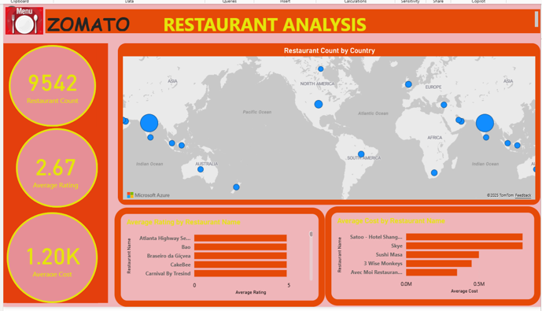
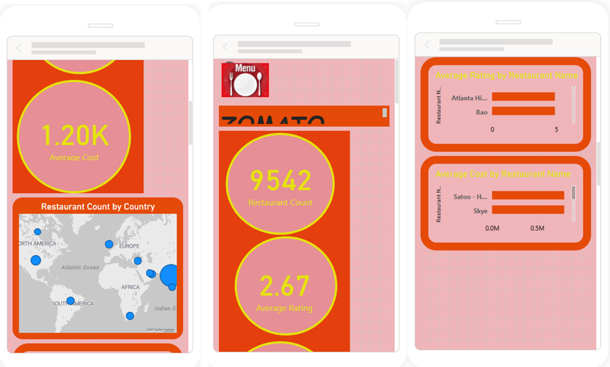
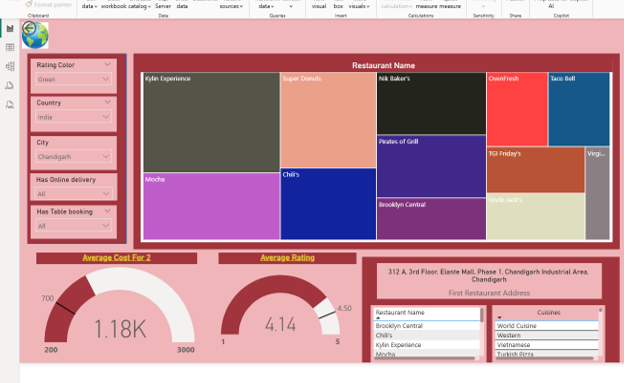
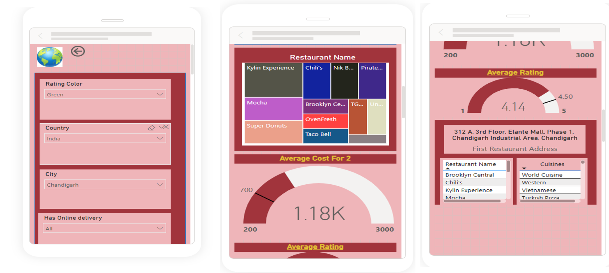

# Zomato Restaurant Analysis | Power BI

## Project Overview

This project uses Microsoft Power BI to analyze restaurant data and explore restaurant distribution, customer ratings, average dining costs, and restaurant-level performance.

The dashboard presents key performance indicators and visualizations to support exploration of restaurant trends across different countries and restaurants.

## Tools and Skills

- Microsoft Power BI Desktop
- Data modeling and relationships
- Data visualization
- Interactive dashboard development
- KPI reporting
- Geographic analysis
- Restaurant performance analysis

## Key Performance Indicators

The dashboard displays the following overall metrics:

- **Total Restaurants:** 9,542
- **Average Rating:** 2.67
- **Average Cost:** Approximately 1.20K

## Analysis Performed

1. **Restaurant Distribution:** Visualized the geographic distribution of restaurants.
2. **Restaurant Ratings:** Compared average ratings across restaurant names.
3. **Restaurant Costs:** Analyzed average costs across restaurants.
4. **Interactive Filtering:** Enabled exploration using filters for restaurant attributes such as country, city, online delivery, and table booking.
5. **Mobile Layout:** Designed a mobile-friendly dashboard view.

## Dashboard Screenshots

### Screenshot 1

### Screenshot 2

### Screenshot 3

### Screenshot 4

## Power BI Project File

[Download the Power BI report](Zomato%20Project%201.pbix)

Open the downloaded file in Power BI Desktop to explore the report.

## Conclusion

This project demonstrates skills in Power BI dashboard development, restaurant data analysis, KPI reporting, and geographic visualization.
